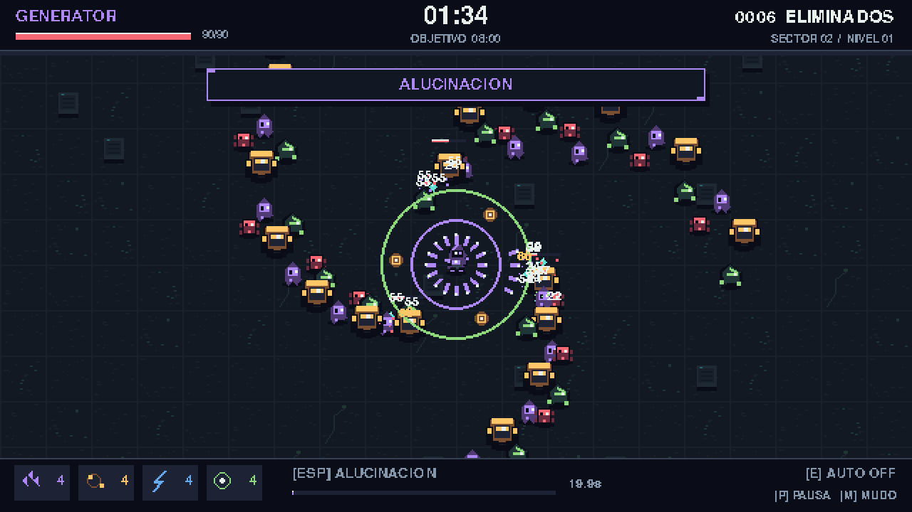

# AGENTFALL

Roguelite de supervivencia hecho con **Python 3 y pygame**. Sobrevive ocho minutos
en una arena infinita: enemigos desde los bordes, ataques automaticos, gemas de
experiencia y tres cartas de mejora al subir de nivel. Todo el pixel art y los
sonidos se generan con codigo; no necesitas descargar recursos externos.



## Ejecutar

Versiones previstas: **CPython 3.12 y 3.13** con `pip` y un entorno de escritorio.
En Windows se recomienda **Python 3.13 de 64 bits**, en su compilacion normal.
La dependencia `pygame==2.6.1` necesita un wheel compatible: usa estas versiones
para evitar los errores de compilacion observados con Python mas reciente.

### Windows: inicio rapido

Instala Python 3.13 si todavia no lo tienes; en la [pagina oficial de Windows](https://www.python.org/downloads/windows/)
busca la serie **3.13** y elige **Windows installer (64-bit)**. Comprueba su
instalacion desde una terminal nueva:

```powershell
py -3.13 --version
```

Descomprime el ZIP o clona el repositorio. Dentro de la carpeta que contiene
`main.py`, haz doble clic en **`run_windows.bat`** o ejecuta:

```powershell
.\run_windows.bat
```

El lanzador crea `.venv313`, instala las dependencias e inicia el juego. La
primera instalacion requiere internet. Tambien acepta opciones, por ejemplo
`.\run_windows.bat --mute`. Para hacerlo manualmente, ejecuta uno por uno:

```powershell
py -3.13 -m venv .venv313
.\.venv313\Scripts\python.exe -m pip install -r requirements.txt
.\.venv313\Scripts\python.exe main.py
```

### Linux / macOS

Con Python 3.12 o 3.13 instalado, abre una terminal dentro del proyecto. Este
ejemplo selecciona expresamente Python 3.13:

```bash
python3.13 -m venv .venv
./.venv/bin/python -m pip install -r requirements.txt
./.venv/bin/python main.py
```

Puedes sustituir `python3.13` por `python3.12`. Si tu distribucion pide el soporte
de `venv`, instala el paquete correspondiente de esa misma version de Python.
Con el entorno correcto ya activado, el arranque sigue siendo:

```bash
python -m pip install -r requirements.txt
python main.py
```

### Opciones

```bash
python main.py --mute         # Comenzar sin sonido
python main.py --seed 42      # Misma secuencia de azar con las mismas acciones
python main.py --smoke-test   # 180 fotogramas sin ventana; termina automaticamente
```

## Controles

| Accion | Teclas / raton |
| --- | --- |
| Seleccionar agente | 1 / 2 / 3, flechas o clic |
| Iniciar | Enter o boton DESPLEGAR |
| Moverse | WASD o flechas |
| Activar habilidad unica | Espacio |
| Alternar autopiloto | E |
| Elegir mejora | 1 / 2 / 3, clic o flechas + Enter |
| Pausar / continuar | P o Esc |
| Activar / desactivar sonido | M |
| Pantalla completa | F11 |
| Reintentar al terminar | R o Enter |
| Cambiar de agente al terminar | Esc o boton |
| Salir | Cerrar la ventana o Esc en seleccion |

El teclado tiene prioridad sobre el autopiloto, que busca gemas y evita amenazas.
Las armas apuntan y disparan solas. Perder el foco pausa la partida.

## Agentes

| Agente | Arma inicial | Pasiva | Habilidad activa |
| --- | --- | --- | --- |
| Planner | Pulso logico | -15% de espera entre ataques | Ralentiza enemigos y acelera armas por 5 s; recarga 23 s |
| Retriever | Indice orbital | Recogida 48 px frente a 29; +35% suerte de botin | Atrae todas las gemas, cura y repele enemigos; recarga 26 s |
| Generator | Fragmentos | +25% de dano | Tres anillos perforantes y proteccion breve; recarga 20 s |

Cada agente tiene tres rangos de mejora exclusiva. La habilidad empieza lista.
La suerte aumenta las probabilidades de gemas adicionales y curacion.

## Armas y progresion

Hay seis armas: **Pulso logico, Fragmentos, Indice orbital, Red neuronal,
Recolector basura y Vector lineal**. Puedes llevar cuatro por partida. Las armas
suben hasta nivel 5 y la siguiente carta del arma la **evoluciona**, cambiando sus
propiedades. Las cartas muestran el dano y el tiempo entre ataques resultantes.

Las mejoras incluyen dano, cadencia, velocidad, salud, recogida, regeneracion,
armadura, suerte y experiencia. La accion se detiene mientras eliges. Si acumulas
varios niveles, recibes una seleccion por nivel; la experiencia sobrante se conserva.
Una construccion completa sigue recibiendo tres suministros diferentes.

Los enemigos ganan vida y velocidad con el tiempo; aparecen nuevos tipos y un elite
cada 75 s. Las gemas cian, azules y violetas indican cantidades crecientes de
experiencia; los corazones recuperan salud. Sobrevivir 08:00 completa la partida.

## Archivos y ampliacion

| Archivo | Responsabilidad |
| --- | --- |
| `config.py` | Paleta, agentes, armas, enemigos, equilibrio y pesos de mejoras |
| `main.py` | Inicializacion y opciones de linea de comandos |
| `game.py` | Bucle, estados, habilidades y simulacion |
| `entities.py` | Jugador, gemas y proyectiles |
| `weapons.py` | Ataques automaticos, niveles y evoluciones |
| `enemies.py` | Enemigos y director de apariciones |
| `upgrades.py` | Generacion ponderada y aplicacion de cartas |
| `ui.py` | Seleccion, HUD, cartas, pausa y resultados |
| `audio.py` | Mixer, sintesis de sonidos y carga intercambiable |
| `sprites.py` | Sprites y suelo repetible generados por codigo |
| `effects.py` | Particulas, destellos, numeros, ondas y temblor |
| `spatial.py` | Cuadricula para colisiones locales |
| `tests/test_core.py` | Pruebas de logica e integracion sin pantalla |
| `AGENTS.md`, `agent.md` | Guia para mantener y ampliar el proyecto con agentes |
| `run_windows.bat` | Instalacion e inicio con Python 3.13 en Windows |
| `.github/workflows/tests.yml` | Pruebas automaticas en GitHub Actions |
| `docs/GITHUB.md` | Pasos para crear y subir el repositorio |

Consulta [agent.md](agent.md) y [AGENTS.md](AGENTS.md) antes de ampliar el juego.
La resolucion interna es 640 x 360; la ventana inicia a 1280 x 720. Se usa
escalado entero por vecino mas cercano y bandas si sobra espacio. Objetivo: 60 FPS,
movimiento con delta time y limites de poblacion/efectos configurables.

## Sonido propio

Coloca archivos `shoot.wav`, `hit.wav`, `death.wav`, `pickup.wav`, `level_up.wav`,
`damage.wav`, `ability.wav`, `game_over.wav`, `victory.wav` o `select.wav` en
`assets/audio/`. Tambien se admite `.ogg`. Cada archivo sustituye solo su efecto;
el resto sigue sintetizado. Si falta un dispositivo de audio, el juego continua.

## Comprobar

```bash
python -m unittest discover -s tests -v
python main.py --smoke-test
```

Las pruebas cubren agentes, armas y evoluciones, habilidades, colisiones de
proyectiles rapidos, pausa, experiencia sobrante, cartas validas, poblacion,
sonidos generados, pantallas y reinicio. Solo se requiere pygame y la biblioteca
estandar. No se necesita un navegador ni un servidor.

En Windows, sustituye `python` por `.\.venv313\Scripts\python.exe` si el entorno
no esta activado. En Linux/macOS usa `./.venv/bin/python`.

## Subir a GitHub

Sigue [docs/GITHUB.md](docs/GITHUB.md) para publicar con Git o GitHub Desktop.
Sube el contenido extraido con `main.py`, `README.md` y `.github/` en la raiz
del repositorio. `.gitignore` excluye entornos virtuales, caches y archivos
generados; `.gitattributes` normaliza los saltos de linea.

El workflow **Tests** esta configurado para ejecutarse al subir cambios y abrir
pull requests, usando Python 3.12 y 3.13 en Windows y Linux. Tambien admite
ejecucion manual desde la pestana **Actions**.

## Prompt de desarrollo

Build a Vampire Survivors-style action roguelite in Python with pygame. The game is a top-down survival loop: the player controls a character that moves automatically or by keyboard, enemies swarm from all sides, weapons fire on their own, and the player collects experience gems to level up and choose upgrades until the run ends.

Requirements:

- **Engine and language:** Python 3 with pygame. Structure the code into modules (game loop, entities, weapons, enemies, upgrades, UI, audio) so the project can grow. Include a `requirements.txt` and a short README explaining how to run it.
- **Pixel art design:** Use a consistent low-resolution pixel art style scaled up with nearest-neighbor filtering. Generate or procedurally draw all sprites in code if no image assets are provided, using a limited, coherent color palette. Include the player, enemies, projectiles, gems, and a tileable background.
- **Playable characters based on AI agents:** Create at least three selectable characters, each represented as a distinct AI agent archetype (for example: a Planner that gains bonus cooldown reduction, a Retriever that gains larger pickup range and drop luck, a Generator that fires stronger projectiles with a unique ability). Each character has a starting ability, a passive trait, and a unique active ability with a cooldown. Show each character's stats and abilities on the selection screen.
- **Upgrades while playing:** When the player levels up, pause the action and show three randomly chosen upgrade cards drawn from weapons, passive stats, and character-specific upgrades. Weapons should evolve or gain levels. Upgrades must have clear, readable descriptions.
- **Sound effects:** Add SFX for shooting, hits, enemy death, gem pickup, level up, player damage, and game over. Use pygame's mixer; if no audio files are supplied, generate simple waveform tones in code so the game runs with sound out of the box, and make the audio loader swappable for real files.
- **Simple visual effects:** Include screen shake on heavy hits, hit flashes on enemies, particle bursts on enemy death, floating damage numbers, and a brief ability visual when an active ability triggers.
- **Core loop and balance:** Enemies spawn at screen edges with difficulty scaling over time. Include a timer, a kill counter, a HUD with health and experience bars, and a game over screen showing run stats with a restart option. Keep frame rate stable at 60 FPS and use delta time for movement.
- **Code quality:** Keep the code readable and commented where non-obvious. Make key values (speeds, spawn rates, upgrade weights, character stats) defined in a single configuration module so the game is easy to tune.

Deliver the complete, runnable project as separate files with their paths, starting with the configuration module and main entry point, so I can run it immediately with `python main.py`.

Includes a readme file with an agent.md
